# Transformer difficult concepts · 难点双语图解

Six topics, twelve images. 六组主题，中英文各一张。

Generated with built-in ImageGen and manually checked. Teaching examples and schematic curves are not experimental results. 内置 ImageGen 生成并逐图核对；数值例子和曲线均为教学示意，非模型实验。

## Q、K、V：匹配、路由、汇聚 / Q, K, V: match, route, combine

Related / 对应：Q2, Q3, Q8

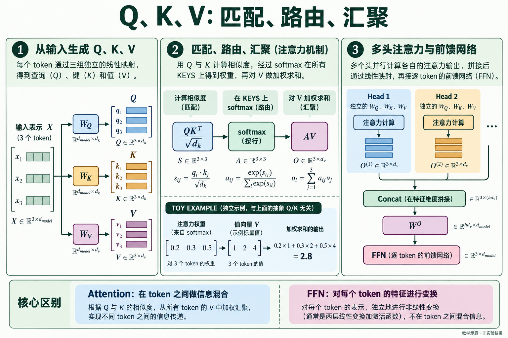

1. 同一输入 X 经不同投影生成 Q、K、V。Q 与 K 决定注意力权重，V 决定被混合的内容。
2. 每个查询沿键的位置做 softmax。教学例子的输出为 0.2×1+0.3×2+0.5×4=2.8。
3. 多个头的输出按特征维拼接，再经 Wᴼ 投影。FFN 独立变换每个词元的特征；图为局部计算路径，省略残差、归一化和 dropout。

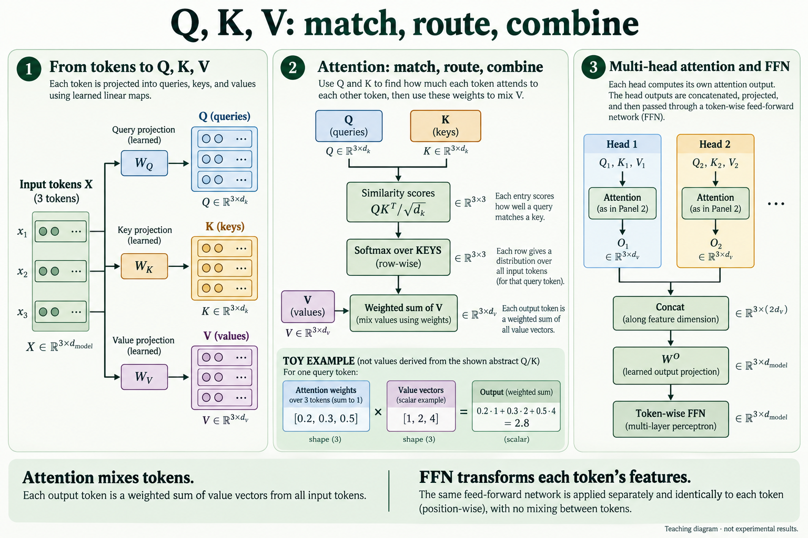

1. Separate projections of X produce Q, K and V. Q/K determine weights; V supplies the content.
2. Softmax normalizes over key positions for each query. The toy output is 0.2×1+0.3×2+0.5×4=2.8.
3. Head outputs concatenate along features, then pass through Wᴼ. The FFN transforms each token separately. This focused path omits residuals, normalization and dropout.

Sources / 依据：[Vaswani et al. · Attention Is All You Need (2017), arXiv v7](https://arxiv.org/html/1706.03762v7)

## 看前缀，不偷看答案 / See the prefix, never the answer

Related / 对应：Q5, Q9, Q12, Q22

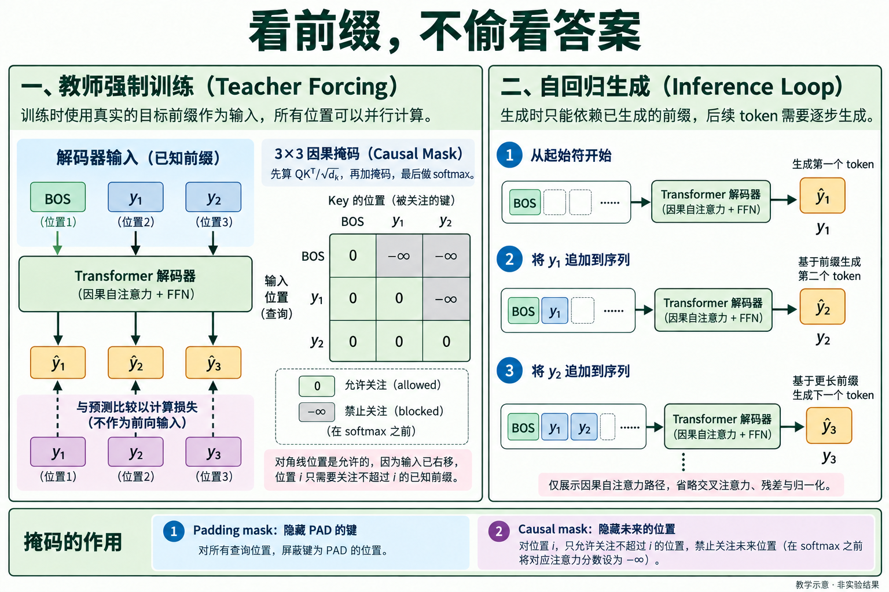

1. 输入 [BOS,y₁,y₂] 对应目标 [y₁,y₂,y₃]。真实标签用于损失比较，不作为当前位置的前向输入。
2. 计算 QKᵀ/√dₖ 后，把禁止位置加上 −∞，再做 softmax。主对角线允许关注，因为输入已经右移。
3. 训练时真实前缀已知，可并行计算各位置；生成时必须逐步追加预测词元。填充掩码与因果掩码分别处理 PAD 和未来位置。

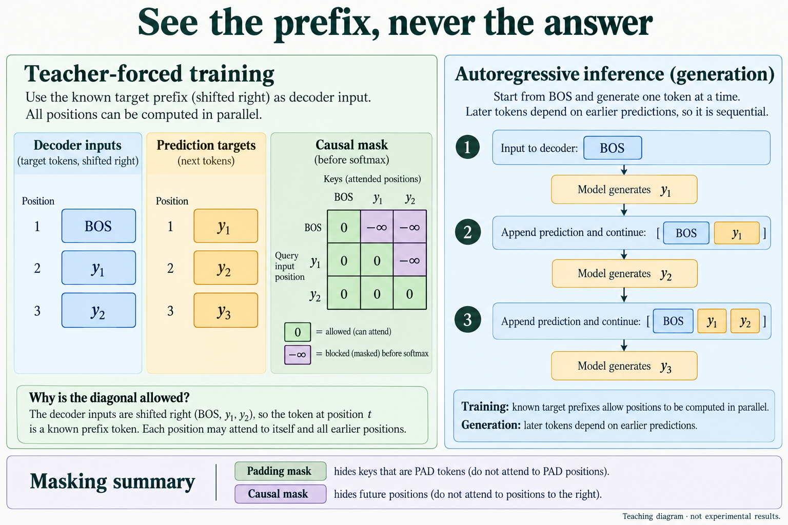

1. Inputs [BOS,y₁,y₂] predict targets [y₁,y₂,y₃]. True labels are compared in the loss, not fed into the current prediction.
2. After QKᵀ/√dₖ, add −∞ at blocked positions, then apply softmax. The diagonal remains allowed because inputs are shifted.
3. Training can compute positions in parallel with known prefixes; generation appends predictions sequentially. Padding and causal masks hide PAD keys and future positions respectively.

Sources / 依据：[Vaswani et al. · Attention Is All You Need (2017), arXiv v7](https://arxiv.org/html/1706.03762v7)

## 参数量，不等于训练成本 / Model size is not training cost

Related / 对应：Q7, Q14, Q23, Q24

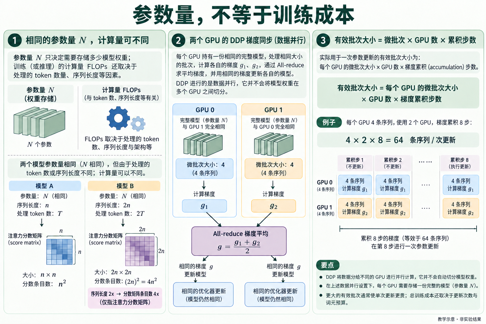

1. 相同参数量下，处理不同的词元数和序列长度会产生不同运算量。n×n 分数矩阵在长度翻倍时有四倍条目；这不是总显存估计。图中网格仅示意。
2. 普通 DDP 每卡保留完整模型，处理不同数据；等大小批量时梯度平均后同步更新。英文图的 θ←θ−ηg 是 SGD 形式示意，实际可用其他优化器。
3. 每卡微批量 4 × 2 卡 × 累积 8 步 = 每次更新 64 条序列。总训练成本还取决于更新次数、有效词元数和实现，不能只看批量。

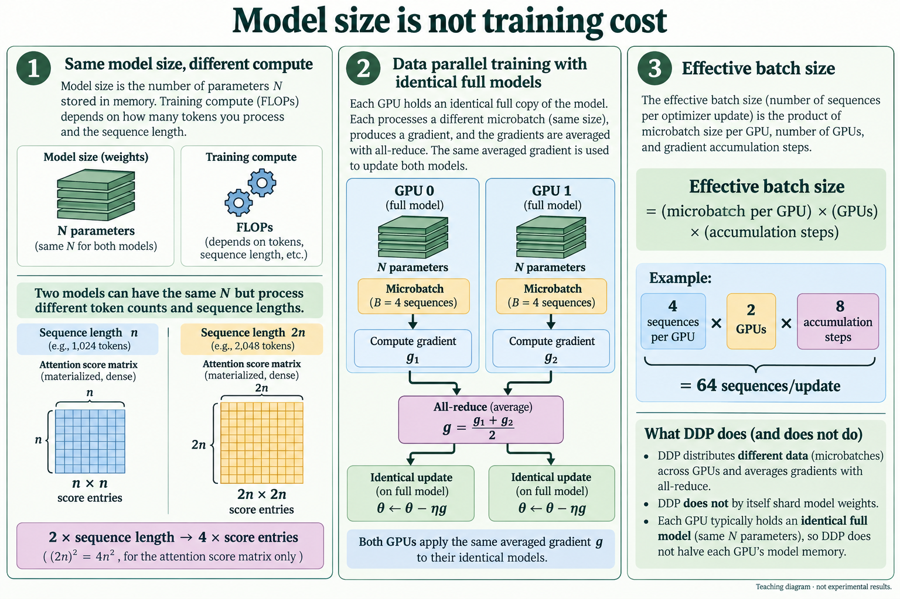

1. With equal parameters, token counts and sequence lengths still change computation. Doubling length gives four times as many n×n score entries, not necessarily four times total memory. Grids are schematic.
2. Ordinary DDP replicates the full model and divides data. Equal-size batch gradients are averaged before matching updates. θ←θ−ηg illustrates SGD; other optimizers are possible.
3. Microbatch 4 × 2 GPUs × 8 accumulation steps = 64 sequences per update. Total training cost also depends on update count, effective tokens and implementation.

Sources / 依据：[Vaswani et al. · Attention Is All You Need (2017), arXiv v7](https://arxiv.org/html/1706.03762v7); [PyTorch · Getting Started with Distributed Data Parallel](https://docs.pytorch.org/tutorials/intermediate/ddp_tutorial.html); [Kaplan et al. · Scaling Laws for Neural Language Models (2020)](https://arxiv.org/abs/2001.08361)

## 损失更低，究竟哪里更好？ / Lower loss: better at what?

Related / 对应：Q17, Q21, Q26, Q27, Q28

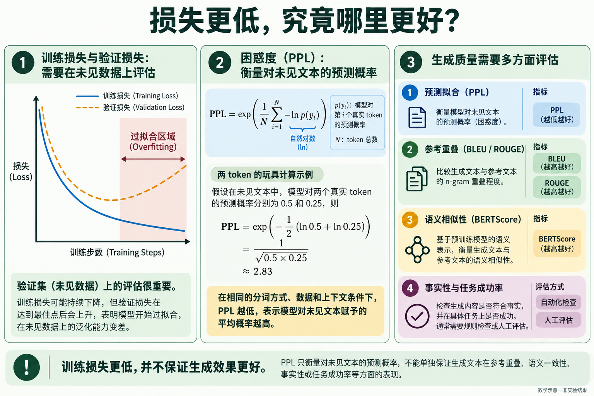

1. 学习曲线是示意：训练损失下降，而验证损失转而上升，是可能过拟合的信号；真实诊断还应排除数据偏移和评估错误。
2. 令 pₜ=p(yₜ|真实前缀)，则 PPL=exp(−平均 ln pₜ)。两个真实目标词元的条件概率为 0.5 与 0.25 时，PPL≈2.83。这里的平均概率指几何平均。
3. 比较 PPL 需固定分词器、数据和上下文口径。BLEU/ROUGE、BERTScore 与事实核验分别回答不同问题，没有一个指标能独自概括质量。

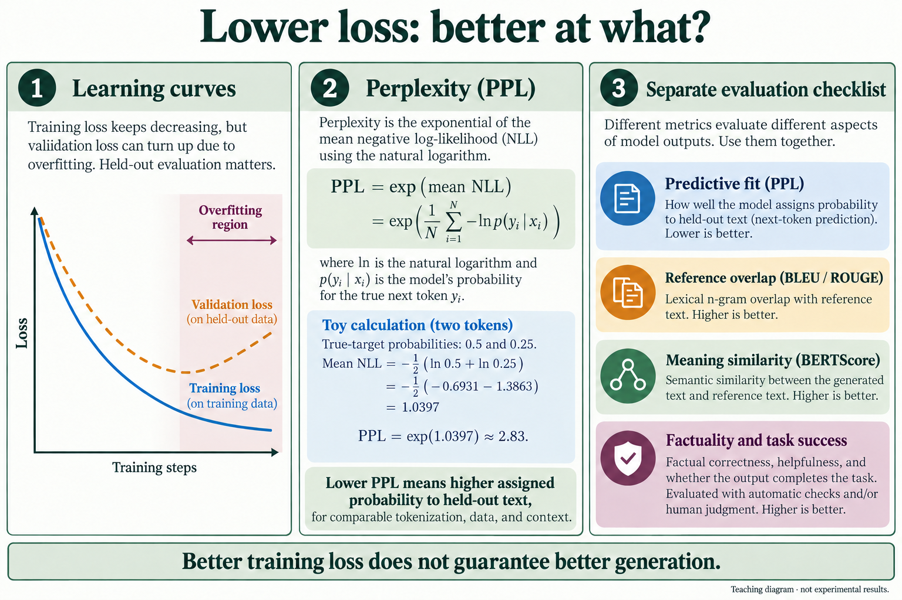

1. The schematic curves show a possible overfitting pattern: training loss falls while validation loss rises. Also check distribution shift and evaluation errors.
2. Let pₜ=p(yₜ|true prefix). PPL=exp(−mean ln pₜ). With target probabilities 0.5 and 0.25, PPL≈2.83. The relevant mean probability is geometric.
3. PPL comparisons require matched tokenization, data and context. BLEU/ROUGE, BERTScore and factual checks answer different questions; no metric alone captures quality.

Sources / 依据：[Hugging Face · Perplexity of fixed-length models](https://huggingface.co/docs/transformers/en/perplexity); [Papineni et al. · BLEU (ACL 2002)](https://aclanthology.org/P02-1040/); [Lin · ROUGE (2004)](https://aclanthology.org/W04-1013/); [Zhang et al. · BERTScore (2019/2020)](https://arxiv.org/abs/1904.09675)

## 同一个模型，不同的生成选择 / One model, different decoding choices

Related / 对应：Q18, Q22, Q29, Q30, Q31

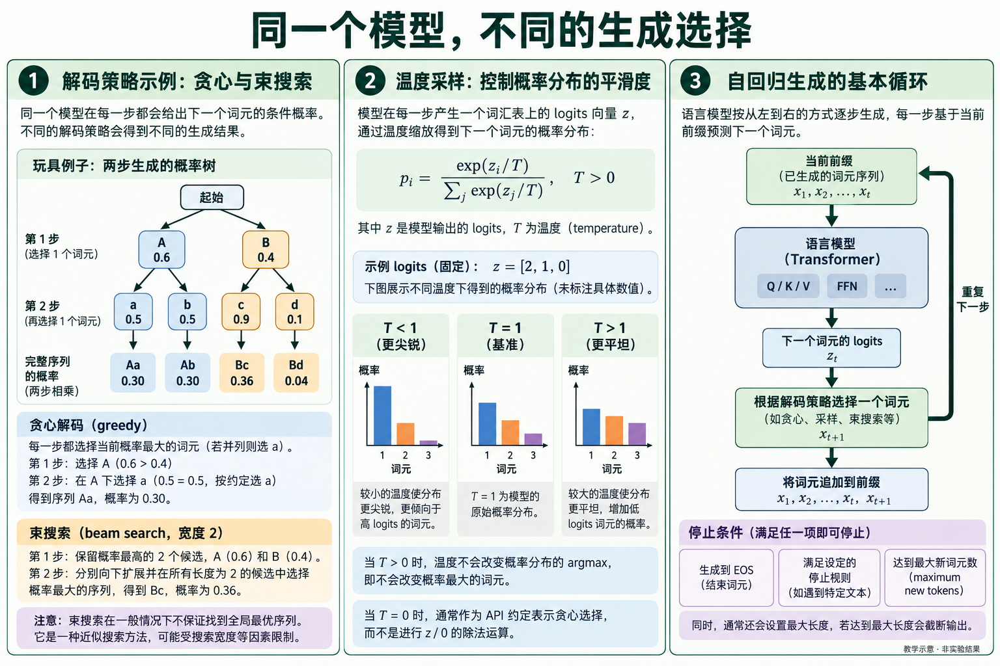

1. 两步玩具例子中，贪心先选 0.6 的 A，最终序列得分 0.30；宽度 2 的束搜索同时保留 A、B，可选到 0.4×0.9=0.36 的 Bc。这不证明束搜索一般都能得到全局最优。
2. 正温度 T 调整采样分布 softmax(z/T)，不改变固定候选集的 argmax 排序。T=0 可能是某些 API 的贪心约定；不能按公式直接除以零。柱形只示意分布形状。
3. 前缀→logits→选词元→追加→重复，遇到 EOS、停止规则或新词元上限结束。长度上限控制资源，但可能截断答案。

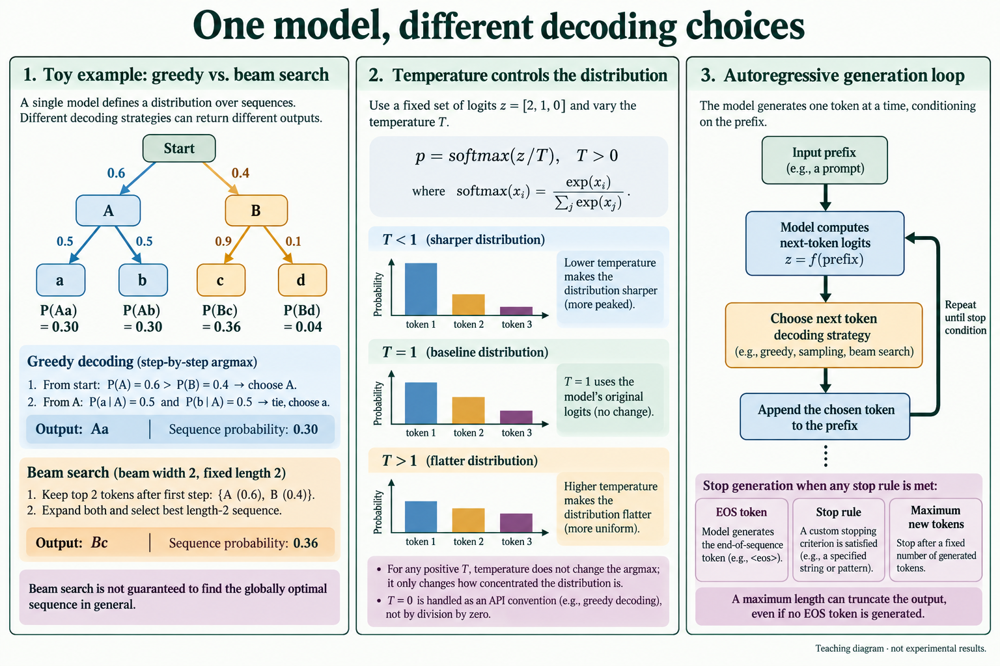

1. In the two-step toy tree, greedy starts with A at 0.6 and ends at 0.30. Beam width 2 keeps A and B and can find Bc at 0.4×0.9=0.36. This is not a general optimality guarantee.
2. Positive temperature changes sampling probabilities softmax(z/T), not argmax ordering for fixed candidates. Zero may be an API convention for greedy selection, never literal division by zero. Bars are schematic.
3. Prefix→logits→select→append→repeat, stopping at EOS, a stop rule or a new-token cap. The cap limits resources but can truncate an answer.

Sources / 依据：[Hugging Face · Generation strategies](https://huggingface.co/docs/transformers/en/generation_strategies); [Hugging Face · Generation configuration](https://huggingface.co/docs/transformers/en/main_classes/text_generation); [Vaswani et al. · Attention Is All You Need (2017), arXiv v7](https://arxiv.org/html/1706.03762v7)

## LoRA 与 Adapter：到底训练什么？ / LoRA and adapters: what actually trains?

Related / 对应：Q13, Q32

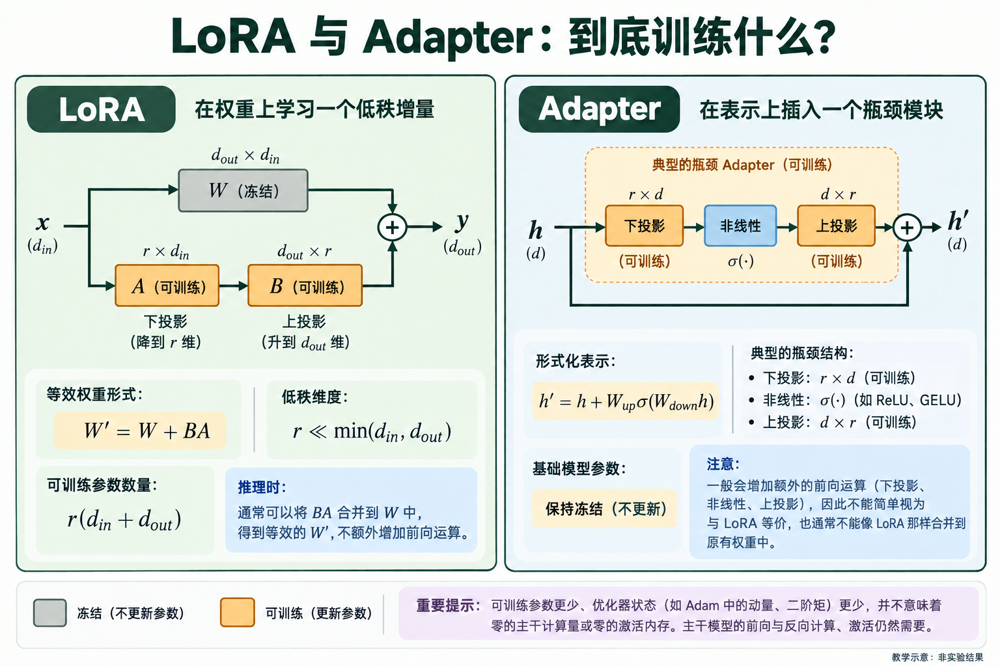

1. LoRA 冻结 W，训练低秩 A、B：x 同时经过 W 和 A→B，两条路径相加。这里省略常用比例系数；图中按有效增量 BA 表示。
2. 低秩增量只有 r(d_in+d_out) 个参数，适用时可合并回 W。典型 Adapter 则是下投影→非线性→上投影，并带残差旁路，通常不能像线性 BA 一样直接合并。
3. 减少可训练参数主要节省梯度与优化器状态，不会消除基座前向/必要反向计算或激活显存；效果需按具体任务评估。

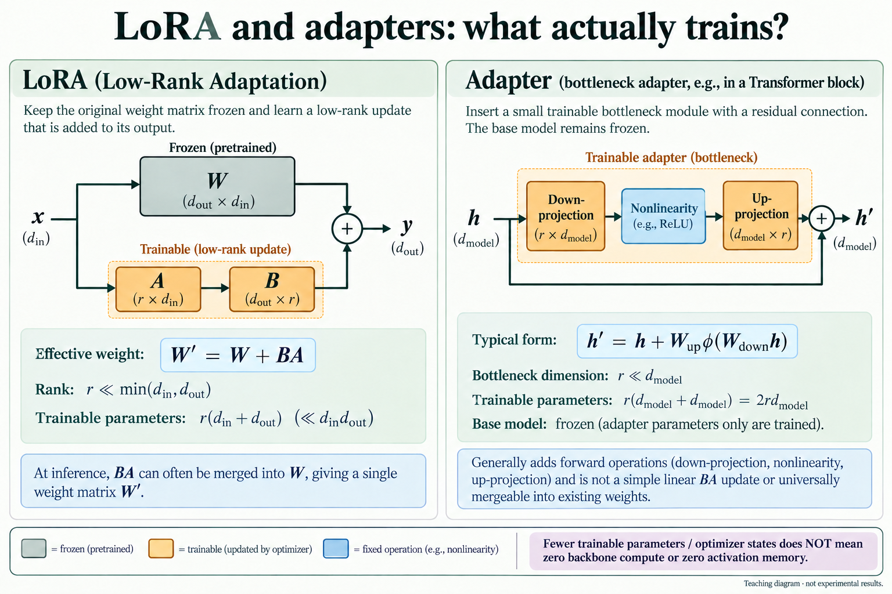

1. LoRA freezes W and trains low-rank A and B. Input x passes through W and through A→B; outputs add. The usual scale factor is absorbed into the effective update BA here.
2. The low-rank update has r(d_in+d_out) parameters and can often merge into W. A typical adapter uses down-projection→nonlinearity→up-projection with a residual bypass and generally cannot merge like linear BA.
3. Fewer trainable parameters save gradients and optimizer state, not all backbone computation or activation memory. Quality still needs task-specific evaluation.

Sources / 依据：[Hu et al. · LoRA: Low-Rank Adaptation of Large Language Models (2021/2022)](https://arxiv.org/abs/2106.09685); [Houlsby et al. · Parameter-Efficient Transfer Learning for NLP (2019)](https://arxiv.org/abs/1902.00751)

